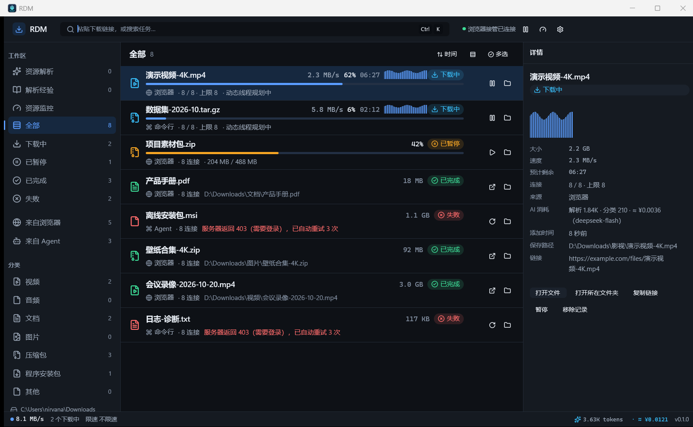

# RDM — Rust Download Manager

纯 Rust 实现的多连接下载器：下载引擎 + **GPUI** 桌面端 + Firefox / Chrome 下载接管扩展
+ **CLI / MCP** agent 接口 + 可验证的链接解析运行时。不套壳 aria2、不依赖 Electron。



> 截图来自实际安装版 `rdm-gui.exe` 的真实运行窗口（非设计稿/旧版本截图）。

## 功能

- **下载引擎**：Range 分块、断点续传、动态线程规划、全局限速、SHA-256 校验、
  失败重试与诚实降级（不支持 Range / 无 Content-Length 时明确回退单流）。
- **桌面端**：任务队列与进度、设置分类、托盘与开机自启动、分类保存路由；
  **资源解析**历史会话页面与**解析经验**库（经验可编辑/删除/版本回滚）。
- **解析经验 2.0**：AI 探索成功后自动沉淀为**可复用模板**（host + 静态路径前缀 + 命名捕获，
  同类新链接 0 次 AI 复用）；同类互补经验可合并为“经验组”一次产出全部资源；
  「使用此经验解析」可对新地址确定性回放；右侧 **AI 经验助手**可整理模板、修复写死参数、
  预览并应用新版本。资源解析页只保留历史与 URL 入口。
- **浏览器扩展**：接管 Firefox/Chrome 下载（保留 Cookie/Referer/UA）、右键转交、
  下载进度徽章/popup、「AI 解析当前页」。
- **Agent 接口**：`rdm` CLI 与 `rdm-mcp`（17 个 MCP 工具），支持下载/解析/任务管理/自检。
- **链接解析**：独立验证器、声明式方法回放、方法库（健康度/回滚/导入导出）、
  可选模型探索与草稿（仅本机）、解析后下载、经验自动发布与修复升级。

## 构建

前置：Rust stable；Windows 构建还需要 MinGW-w64 GCC 在 `PATH`。

```powershell
cargo build --workspace
cargo test --workspace --no-fail-fast     # 可选
```

Windows 桌面端（安装版，含 GUI 子系统与 native host）：

```powershell
pwsh -File scripts/install-local-build.ps1
```

Chrome 扩展构建产物（Firefox 直接加载 `extension/firefox`）：

```powershell
pwsh -File scripts/build-chrome-extension.ps1
```

## 仓库结构

- `crates/` Rust 工作区：下载引擎（`rdm-core`）、CLI、GUI、MCP、native host、解析运行时等。
- `extension/` Firefox / Chrome MV3 扩展源码。
- `assets/` 品牌图标与 README 截图。
- `scripts/` 构建/安装/宿主注册脚本。

## 分支说明

本仓库对外只发布 **`master`**：它是版本收尾快照，仅包含源代码与根 README（及 README
必需的截图/构建资产）。日常开发在非公开的 `dev` 分支进行；架构、QA、研究等开发文档不在
本分支。

## 说明

- 仅 Windows 构建/运行经过验证；Linux/macOS 未验证。
- 真实站点/真实 LLM/真实浏览器接管行为需使用者自行验证；发布分支不含测试报告。

