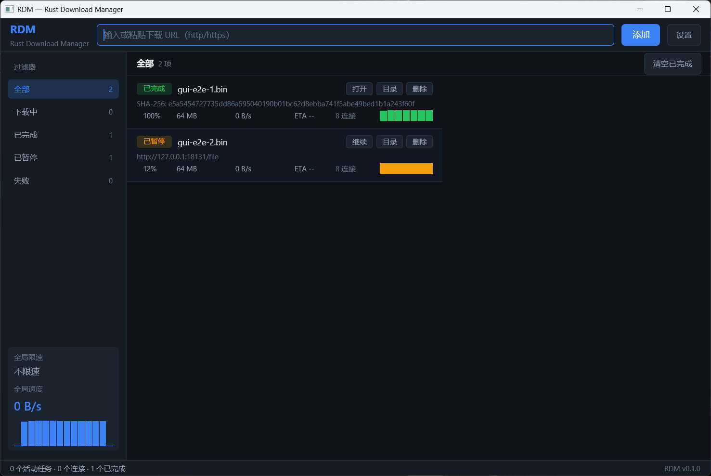

# RDM — Rust Download Manager

> 纯 Rust 实现的多连接下载器：**GPUI** 桌面端 + Firefox 接管扩展 + **agent 接口（MCP/CLI/SKILL）**
> + 可复现的本地基准。不套壳 aria2、不依赖 Electron；把「分段下载的正确性、可观测性和
> agent/浏览器交接」做成可验证的工程。
>
> **独立验收（commit b8dfc88）**：构建 PASS，**140/140 测试通过**，`cargo fmt --check` 干净，
> 引擎行为 7/7、GUI e2e 22/22、1 vs 8 连接 **7.77x**（64MiB release 5 次中位）。
> 报告：[docs/qa-report.md](docs/qa-report.md)。
>
> **Agent 接口（commit 修复版）**：MCP stdio server（legacy + modern discover）、16 工具、
> CLI JSON 信封、SKILL；本机 `cargo test --workspace` **277 passed / 0 failed**，
> MCP stdio e2e **177 assertions / 0 failures**，`rdm selftest` 4/4、`rdm bench` 1→8 连接
> 8MiB **5.75x**（SHA 一致）。契约：[docs/agent-integration.md](docs/agent-integration.md)，
> SKILL：[skills/rdm/SKILL.md](skills/rdm/SKILL.md)。



## 目录

- [01 · 这是什么](#01--这是什么)
- [02 · 为什么做 RDM（调研结论）](#02--为什么做-rdm调研结论)
- [03 · 多线程下载的真正难点](#03--多线程下载的真正难点)
- [04 · RDM 的差异化优势](#04--rdm-的差异化优势)
- [05 · 实测数据](#05--实测数据)
- [06 · 快速开始](#06--快速开始)
- [07 · Firefox 集成](#07--firefox-集成)
- [08 · Agent 集成（MCP / CLI / SKILL）](#08--agent-集成mcp--cli--skill)
- [09 · 架构](#09--架构)
- [10 · 测试与验收](#10--测试与验收)
- [11 · 目录结构](#11--目录结构)
- [12 · 已知限制与路线图](#12--已知限制与路线图)
- [13 · 命名说明](#13--命名说明)

## 01 · 这是什么

RDM 是一个从零实现的 HTTP(S) 多连接下载器，工作区为纯 Rust（除浏览器扩展必须使用 JS 外）：

| 组件 | 说明 |
|---|---|
| **rdm-core** | 下载引擎：HEAD/Range 探测、块级工作窃取、N 连接并发、崩溃安全续传、无 Range 自动降级、全局限速、SHA-256 校验、进度事件流 |
| **rdm-gui** | **GPUI**（Zed 的 GPU 渲染框架）桌面端：暗色三栏、虚拟列表、实时速度曲线、暂停/继续/取消、设置、单实例、本地 IPC |
| **rdm**（CLI） | 无头下载 + JSONL 事件输出，基准测试与自动化的入口 |
| **rdm-native** | Firefox native messaging 宿主：4 字节长度分帧、GUI 自动拉起、离线 spool 队列、脱敏日志 |
| **Firefox 扩展** | Manifest V3：接管浏览器下载（保留 Cookie/Referer/请求头）、右键菜单、状态徽章、中文设置页 |
| **rdm-ipc** | GUI ↔ 原生宿主：`127.0.0.1` + 随机 token + JSONL |
| **rdm-fixture-server** | 可注入延迟/故障/200 忽略 Range/ETag 变化/429 的本地 HTTP 服务器，测试与基准的一等公民 |

## 02 · 为什么做 RDM（调研结论）

完整调研（含 GitHub API 实测数据与来源链接）见
**[docs/research/competitive-landscape.md](docs/research/competitive-landscape.md)**。

- **头部不是引擎，而是壳**：Motrix（约 5.7 万★）= Electron + aria2 子进程；imfile 是它的
  fork。真正自研引擎且长期活跃的开源 GUI 下载器极少（Gopeed 是少数例外）。
  Electron + GPL 引擎（子进程 + JSON-RPC 隔离）是"法律 + 工程"双捷径，代价是体积、内存、
  供应链与攻击面（aria2 #2402 未鉴权 RPC → 任意文件写入）。
- **"开源多线程下载器少"是伪命题，真问题是"活下来的少"**：GitHub 上 `download manager
  language:rust` 有 344 个仓库，Top1 仅 298★；大量项目 2026 年新建、模板化、无维护。
  稀缺的不是分段代码，而是**长期维护 + 可验证的正确性**。
- **浏览器集成是第二产品**：MV3 后浏览器内已无法做多线程分段（DownThemAll 转 WebExtension
  后失去该能力），必须 native 进程 + native messaging；而宿主的安装、注册表/清单、商店审核
  构成持续摩擦。uGet 为此单独维护 `uget-integrator`，2019 年后停更。
- **服务器侧限制是日常失败模式**：Range 可以被合法忽略、CDN 边缘可能内容不一致、签名 URL
  会过期、按连接数/速率风控（Gopeed #1592/#1593 出现过 403 后永久 running）。这些都是
  "多线程下载器"必须处理、但多数产品处理不好的地方。

> 同名提醒：GitHub 已有 `rdm-dl/rdm` 等同名/同题项目；RDM 不依赖缩写，对外请写全
> "RDM — Rust Download Manager"，并只引用可复现的数据。

## 03 · 多线程下载的真正难点

完整清单（协议/并发/磁盘/恢复/UI/IPC/打包，共 40+ 条）见调研报告 §3。核心几条：

1. **Range 只是"允许"不是"保证"**：服务器可以返回 `200` 忽略 Range；`206` 的
   `Content-Range` 也可能与请求不符；`Accept-Encoding` 会让字节偏移语义变化。
   正确做法是探测 + 逐块校验 + 诚实降级。
2. **HTTP/2 的"假多线程"陷阱**：h2 下 N 个 Range 流复用同一条 TCP、共享同一个拥塞窗口，
   带宽增益≈0。**分段模式必须显式使用 HTTP/1.1 多连接**（RDM 已强制 `http1_only` 并记录
   `http_version` 到结果中）。
3. **断点续传的正确性**：ETag/Last-Modified/总长校验、状态文件与实际落盘的顺序、崩溃窗口、
   416/If-Range、跨卷 rename……任何一处错都是**静默损坏**。
4. **失败模式与限速**：429/503 + `Retry-After`、连接数风控、全局令牌桶（不是每连接限速）。
5. **可测试性**：没有可控 fixture server，就只能靠用户环境复现——这正是竞品
   "99% 卡死 / 403 后永远 running" 类 bug 长期存在的原因。

## 04 · RDM 的差异化优势

诚实分类：**多连接、断点续传、限速、校验、浏览器接管本身都是行业标配**，不能当卖点。
RDM 真正可辩护的是下面四条（逐条对应验证方式）：

| # | 优势 | 对应瓶颈 | 验证方式 | 状态 |
|---|---|---|---|---|
| 1 | **可复现的正确性**：fixture 故障注入矩阵 + 字节级断言 | 竞品普遍缺故障矩阵，静默损坏/卡死无法复现 | 12 项集成测试（200 降级、ETag 变化、resume 字节 delta、checksum 零残留、429、无长度单流…） | ✅ 已实现并通过 |
| 2 | **无外部进程的原生栈**：纯 Rust 引擎 + GPUI，无 Electron/CEF、无 aria2 子进程 | 体积/内存/启动/供应链/攻击面 | 产物与进程数可审计；QA 实测 GUI 启动到可交互 ~378ms、空载 WorkingSet 69.1MB、单进程（debug 构建） | ✅ 已实现，release 数据待补 |
| 3 | **Firefox-first 完整链路**：MV3 扩展 + native host + IPC + 离线 spool | Chromium-first 是红海；Firefox 侧 DTA 已放弃多线程、uGet 半停滞 | `web-ext lint` 0 error、20 项 JS 测试、53+5 项 Rust 测试、headless Firefox 临时加载、native→真实 GUI e2e、安装脚本实测 | ✅ 已实现（真实接管需人工验证） |
| 4 | **诚实降级与限速语义**：Range 不支持时明确 `range_supported=false`；限速是全局的；256KiB 块级工作窃取 | "假装多线程"与"每连接限速"是常见坑 | 200 降级测试、全局限速测试（实测 1.10x 配置值）、1 vs 8 基准 | ✅ 已实现并通过 |

> 不宣传：任何"比 aria2 快"、"企业级安全"、"全平台已支持"的说法。RDM 目前只验证了
> Windows + GNU 工具链；Linux/macOS 代码路径存在但未验证。

## 05 · 实测数据

> 环境：Windows 11（10.0.26300），AMD Ryzen 7 9700X（8C/16T），32GB RAM，
> rustc 1.99.1 `x86_64-pc-windows-gnu`，debug 构建。fixture server 本地回环，
> 文件 32 MiB，每 256 KiB 人工延迟 30 ms（模拟每连接 ~8.3 MiB/s 的服务器限速）。
> 数据由 `rdm-cli --json` 的 `completed.elapsed_ms` 计算，3 次取中位。

| 连接数 | 墙钟时间 | 吞吐 |
|---|---:|---:|
| 1 | 5.067 / 5.123 / 5.050 s | 6.31 / 6.25 / 6.34 MiB/s |
| 8 | 0.672 / 0.639 / 0.709 s | 47.58 / 50.06 / 45.08 MiB/s |

**加速比中位 ≈ 7.5x**；单连接与 8 连接产出的文件 SHA-256 完全一致（`http_version` 均为
`HTTP/1.1`，即真实多 TCP 连接而非 h2 复用）。

> 独立验收（QA，release 构建，commit b8dfc88）：64 MiB / 每 256 KiB 20 ms / 5 次中位，
> CLI **7,972 ms → 1,026 ms = 7.77x**；240 个 206 响应全部 HTTP/1.1；所有运行 SHA-256 一致。
> 两套数字配置不同，只用于证明量级与可复现性。

其他已验证行为：

- **断点恢复**：8 连接下载 64 MiB 中途强制 kill，重启后 `resumed_chunks=8/32`，
  只补缺失块，最终哈希与参考一致。
- **Range 被忽略**：服务器强制 `200` 时自动降级为单流，`range_supported=false`，哈希正确。
- **校验失败**：错误 SHA-256 返回 `ChecksumMismatch`，**不重命名、不残留 `.part`/状态文件**。
- **全局令牌桶**：8 连接、`--limit 16MiB/s`，实测平均 17.64 MiB/s（1.10x 配置值，阈值 1.5x）。
- **h2 观测**：分段模式强制 HTTP/1.1（避免共享拥塞窗口）；单流降级才允许 h2。

可复现命令见 [scripts/benchmark.ps1](scripts/benchmark.ps1)，完整验收见
[docs/qa-report.md](docs/qa-report.md)。

## 06 · 快速开始

前置（Windows，本机已验证，无需管理员/Visual Studio）：

- Rust stable（`x86_64-pc-windows-gnu` toolchain）
- MinGW-w64 GCC 在 `PATH`（本机 WinLibs 16.2.0 UCRT）
- GUI 首次编译会拉取 GPUI 依赖并编译约 4–5 分钟

```powershell
# 1) CLI + native host
cargo build -p rdm-cli -p rdm-native

# 2) 命令行下载（8 连接，JSONL 事件）
cargo run -p rdm-cli -- download https://example.com/big.iso -d downloads -c 8 --json

# 3) probe 元数据
cargo run -p rdm-cli -- probe https://example.com/big.iso --json

# 4) 启动 GPUI 桌面端
cargo build -p rdm-gui
.\target\debug\rdm-gui.exe
# 或带 URL 启动（已有实例则会 IPC 投递后退出）
.\target\debug\rdm-gui.exe https://example.com/big.iso
```

> 注意：GPUI debug 构建在 Windows 上需要 comctl32 v6 manifest 与 MinGW 默认 manifest 的
> 冲突处理，仓库已通过 `crates/rdm-gui/build.rs` 解决（详见 `docs/architecture.md` §8）。
> release 构建的 GPUI 着色器需要 Windows SDK 的 `fxc.exe`，当前交付以 debug 构建验证。

## 07 · Firefox 集成

```powershell
# 1) 构建并安装 native messaging host（用户级 HKCU，无需管理员）
cargo build -p rdm-native
powershell -ExecutionPolicy Bypass -File scripts/install-firefox-host.ps1

# 2) Firefox → about:debugging#/runtime/this-firefox → 临时载入附加组件
#    选择 extension/firefox/manifest.json
```

- 扩展默认接管普通 http(s) 下载：观察 `webRequest` 头 → `downloads.onCreated` →
  `cancel/erase` → 经 native messaging 交给 RDM；保留 Cookie/Referer/UA/Content-Disposition。
- GUI 未运行时会自动拉起（8s 超时、每 200ms 轮询）；仍失败则落 spool 队列（**剥离
  Cookie/Authorization**，响应 `credentials_stripped: true`），下次 GUI 启动自动入队。
- 失败回退浏览器原生下载并防循环；右键菜单可手动「使用 RDM 下载」。
- 上架 AMO 前需处理签名、`data_collection_permissions` 与开发文件排除（见扩展 README）。

## 08 · Agent 集成（MCP / CLI / SKILL）

RDM 不只是"给人用的下载器"：agent 可以通过三条稳定通道驱动它，而不必读源码猜参数。
完整契约（工具 schema / 错误码 / 任务模型 / 策略）见
[docs/agent-integration.md](docs/agent-integration.md)。

**① MCP server（stdio，推荐）**

```jsonc
// mcp.json（DSH / Claude Code / Codex 等支持 stdio MCP 的运行时）
{
  "mcpServers": {
    "rdm": {
      "command": "C:\\Users\\you\\Documents\\RDM\\target\\debug\\rdm-mcp.exe",
      "args": []
    }
  }
}
```

16 个工具：`rdm_capabilities`、`rdm_probe`、`rdm_download`、`rdm_plan_download`、
`rdm_apply_plan`、`rdm_list_tasks`、`rdm_get_task`、`rdm_wait_task`、`rdm_pause_task`、
`rdm_resume_task`、`rdm_cancel_task`、`rdm_verify_file`、`rdm_doctor`、`rdm_selftest`、
`rdm_bench`、`rdm_state_maintenance`；另有 resources（`rdm://capabilities`、`rdm://policy`、
`rdm://schema`、`rdm://tasks`）与 prompts（`download`/`batch_download`/`diagnose_failure`）。
支持 progress 通知、取消等待、结构化错误（`error.code` + `retryable` + `hint`）。

**② CLI（任何能执行子进程的 agent）**

```powershell
rdm capabilities --output json          # 能力/限制/工具清单，自描述
rdm probe https://example.com/f.iso --output json
rdm download https://example.com/f.iso -d C:\Downloads --output json
rdm run --input tasks.json --wait --output json
rdm tasks --output json; rdm task <id> --events 50 --output json
rdm doctor --url https://example.com/f.iso --output json
rdm selftest --output json
```

- 所有命令共享一个 JSON 信封（`schema_version=rdm.agent/v1`、`ok`、`error.code`、`meta`）。
- `--output ndjson` 输出带 `seq`/`ts` 的事件流（probe/progress/retry/completed/failed）。
- 退出码：0 成功、2 失败、3 paused/cancelled、4 policy/approval/conflict。
- 协议版本：legacy `2025-06-18`（兼容 2024-11-05/2025-03-26）完整支持；modern
  `2026-07-28` 的 `server/discover`/每请求 `_meta`/`resultType` 基础兼容（MRTR/Tasks 扩展为 P1）。

**③ SKILL**：[skills/rdm/SKILL.md](skills/rdm/SKILL.md)（决策树 + 工具速查 + 配方 + 错误处理），
配合 [skills/rdm/reference.md](skills/rdm/reference.md) 与 [llms.txt](llms.txt)，
agent 不读源码即可完成 90% 下载任务。

**安全与可维护（agent 必需）**

- **策略文件** `%LOCALAPPDATA%\RDM\agent\policy.json`：限制 host/目录/单任务字节/并发；
  默认禁止私有地址与云 metadata（SSRF 防护），重定向后二次校验；未知长度也强制预算。
- **审批**：超过阈值返回 `needs_approval` + plan，需 `rdm_apply_plan` 两步确认；
  v1 token 为防误触，非人工审批（human-in-the-loop 为 P1）。
- **幂等**：`idempotency_key` 重复调用返回同一 task；任务持久化在
  `%LOCALAPPDATA%\RDM\agent`（每任务独立文件，CLI/MCP 可共存）。
- **脱敏**：Cookie/Authorization 永不出现在 agent 可见输出、事件 journal 与日志中。
- **自检/维护**：`rdm selftest`（引擎 readiness）、`rdm doctor`（环境/网络/策略/状态）、
  `rdm bench`、`rdm state inspect|repair`（孤儿 `.part`、损坏状态；默认 dry-run）。
- **可发现性**：`AGENTS.md`、`llms.txt`、`rdm schema --output json`。

## 09 · 架构

```
Firefox MV3 ──native messaging──► rdm-native ──JSONL+token──► rdm-gui (GPUI)
       │                              │                          │
       └── downloads/webRequest       └── spool 队列              │ rdm-core API
                                                                  ▼
                                                     probe → plan → N workers
                                                     块级工作窃取 + Range + HTTP/1.1
                                                     .part + 原子 resume state
                                                                  │
  rdm (CLI) ─────────────────────────────────────────────────────► rdm-core
```

关键设计：

- **工作窃取**：文件切成固定块（默认按 `total/(connections*4)` 推导，上限 4 MiB），
  所有块进入原子索引队列，空闲 worker 动态领取；慢连接只拖慢自己手上的块。
- **崩溃安全**：数据写 `<target>.part`，状态写 `<target>.part.json`（原子 rename），
  每 500ms/16 块落盘；恢复前校验 total/ETag/Last-Modified/chunk 几何。
- **诚实降级**：HEAD/`Range: bytes=0-0` 探测；不支持 Range → 单流 + `range_supported=false`；
  无 Content-Length → 单流。
- **失败重试**：指数退避 + 抖动，尊重 `Retry-After`；校验失败绝不 rename。
- **UI 数据流**：引擎事件经 tokio mpsc 泵入 GPUI 主线程，250ms 节流合并后 `cx.notify()`。

完整契约见 [docs/architecture.md](docs/architecture.md)，浏览器协议见
[docs/extension-protocol.md](docs/extension-protocol.md)。

## 10 · 测试与验收

```powershell
cargo test -p rdm-core          # 18 单元 + 12 集成（fixture 故障矩阵）
cargo test -p rdm-ipc -p rdm-native -p rdm-gui
cargo test -p rdm-agent -p rdm-mcp -p rdm-cli   # agent 契约 / MCP / CLI
node --test "extension/firefox/test/*.test.js"     # 20 项 JS 测试
npx web-ext lint --source-dir extension/firefox
```

- 引擎：18 单元 + 12 集成，覆盖 200 降级、ETag 变化、resume 字节级 delta、checksum、
  429、无长度、Content-Disposition、限速、h1 断言、redirect/probe 边界。
- GUI：48 项单元/状态机测试（gui-dev）；QA 独立 GUI e2e **22/22 PASS**（隔离环境）：
  启动到发布 ipc.json 378ms、空载 WorkingSet 69.1MB、enqueue 64MiB→进度→completed、
  pause/resume/cancel、单实例 URL 投递、截图证据。
- 浏览器侧：53+5 项 Rust 测试、20 项 JS 测试、`web-ext lint` 0 errors / 0 warnings；
  native host → 真实 GUI 端到端 PASS（自动拉起 542ms、8MiB 下载、SHA-256 一致、日志脱敏）。
- **Agent 接口**：`rdm-agent` 28 + `rdm-cli` 31+34 + `rdm-mcp` 40+4 项测试；MCP stdio
  e2e 177 assertions / 0 failures（initialize/16 tools/下载/wait/verify/进度/取消/pause/resume/
  审批/冲突/脱敏/dual-era/EOF）；QA 独立 conformance harness（`scripts/mcp_e2e.mjs`）。
- 本机全量 `cargo test --workspace`：**277 passed / 0 failed**；`cargo fmt --check` 0 diff；
  `rdm-agent/rdm-mcp/rdm-cli` clippy 0 warning。
- 独立验收（commit b8dfc88）：**140/140 测试通过**，`cargo fmt --check` 0 diff，
  clippy 0 error/0 warning；引擎 release 行为 7/7、GUI e2e 22/22。详见
  [docs/qa-report.md](docs/qa-report.md)；agent 接口验收见 `docs/qa-report-agent.md`（单独 QA）。

## 11 · 目录结构

```
crates/rdm-core            下载引擎（库，唯一状态机）
crates/rdm-agent           agent 共享契约（TaskStore/错误码/Policy/工具 schema）
crates/rdm-mcp             MCP stdio server（16 工具 + resources + prompts，legacy/modern）
crates/rdm-cli             `rdm` 命令行（agent 子命令/JSON 信封/退出码）
crates/rdm-gui             GPUI 桌面端（同时是 IPC server）
crates/rdm-ipc             GUI ↔ native host 本地协议
crates/rdm-native          Firefox native messaging host
crates/rdm-fixture-server  可控 HTTP fixture（测试/基准）
extension/firefox          Firefox MV3 扩展
skills/rdm/                agent SKILL（决策树/工具速查/配方）
docs/                      架构、协议、agent 契约、调研、验收、证据截图
scripts/                   安装、基准、截图、MCP conformance harness
AGENTS.md / llms.txt       给 coding agent 的仓库导航 / 机器可读索引
```

**Agent 相关文档**：[agent-integration.md](docs/agent-integration.md)（契约）、
[agent-cli-reference.md](docs/agent-cli-reference.md)、[agent-mcp-reference.md](docs/agent-mcp-reference.md)、
[docs/research/agent-tool-design.md](docs/research/agent-tool-design.md)（MCP/工具设计调研）、
[docs/research/mcp-dual-era-notes.md](docs/research/mcp-dual-era-notes.md)（MCP 2026-07-28 双代际）。

## 12 · 已知限制与路线图

- 仅 HTTP(S) 分段下载；BT、视频站点解析、HLS/DASH 不在核心范围（插件层规划）。
- 服务器忽略 Range 时无法加速（协议硬限制，UI 会标记）；无 ETag/Last-Modified 时只能靠长度校验。
- Firefox 扩展声明 128+；真实浏览器接管行为需人工在真实站点验证；GUI 离线 spool 会剥离凭据。
- 仅 Windows + GNU 工具链完成构建/运行验证；Linux/macOS 未验证。
- GPUI 为 pre-1.0；release 构建需 Windows SDK fxc；GUI debug 依赖本机 cargo registry 中的
  GPUI 着色器源。
- 路线图：release 打包/签名、macOS/Linux 验证、多源镜像、调度队列、AMO 上架。

## 13 · 命名说明

RDM = **R**ust **D**ownload **M**anager。GitHub 上存在同名的 `rdm-dl/rdm` 等项目，"RDM"
缩写也被 Remote Desktop Manager / Redis Desktop Manager 占用；本项目与其无关，对外请使用
全称并引用本仓库的可复现数据。

## License

MIT OR Apache-2.0

